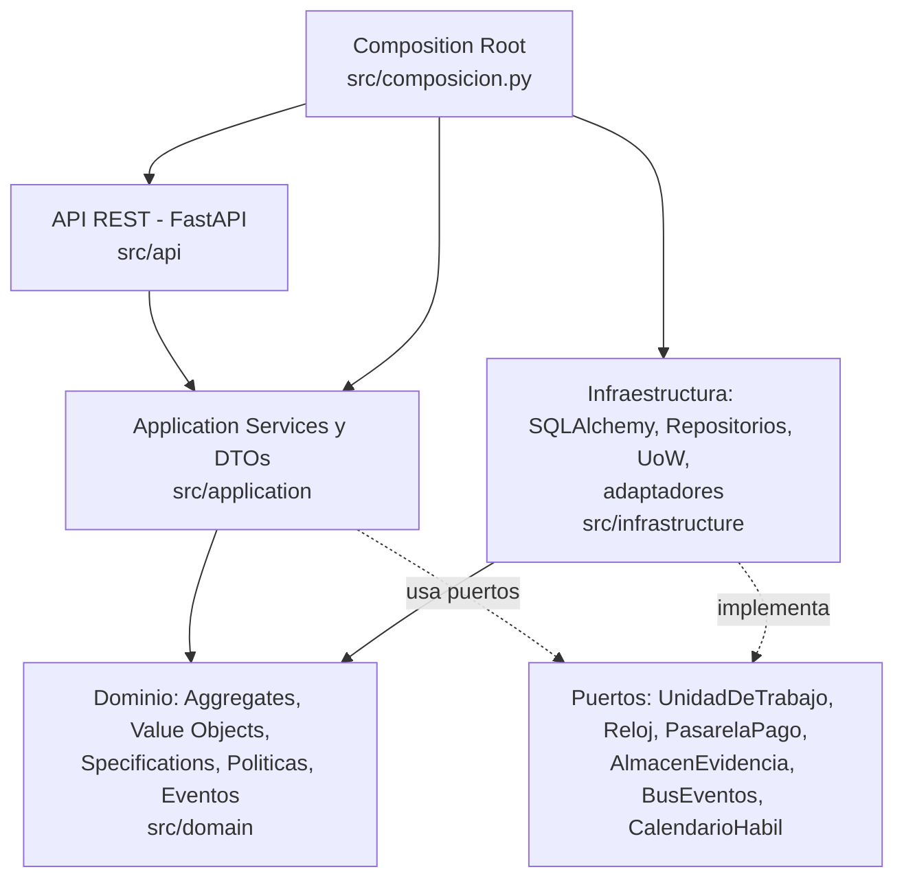
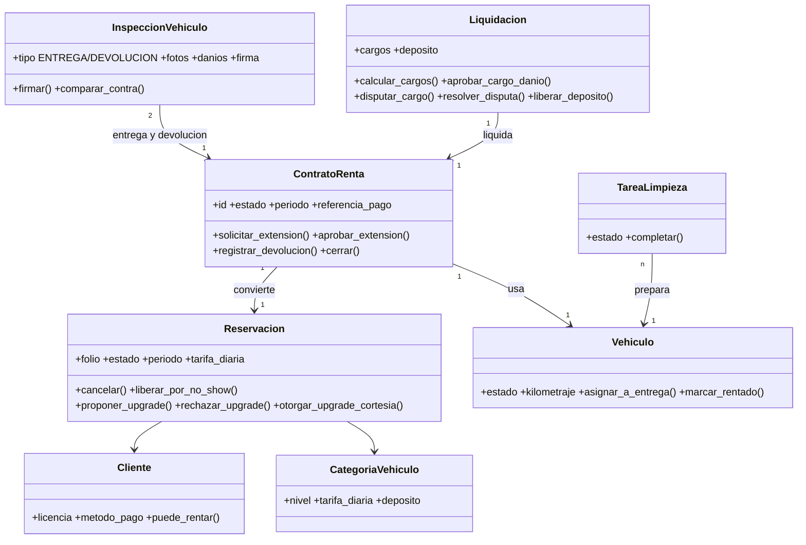
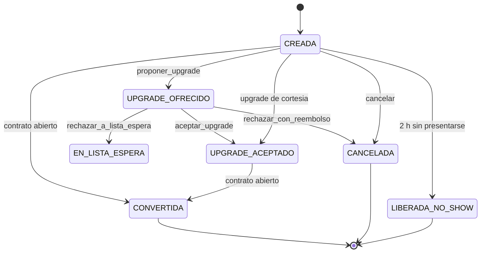
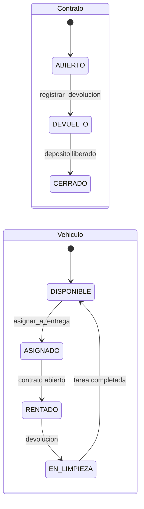
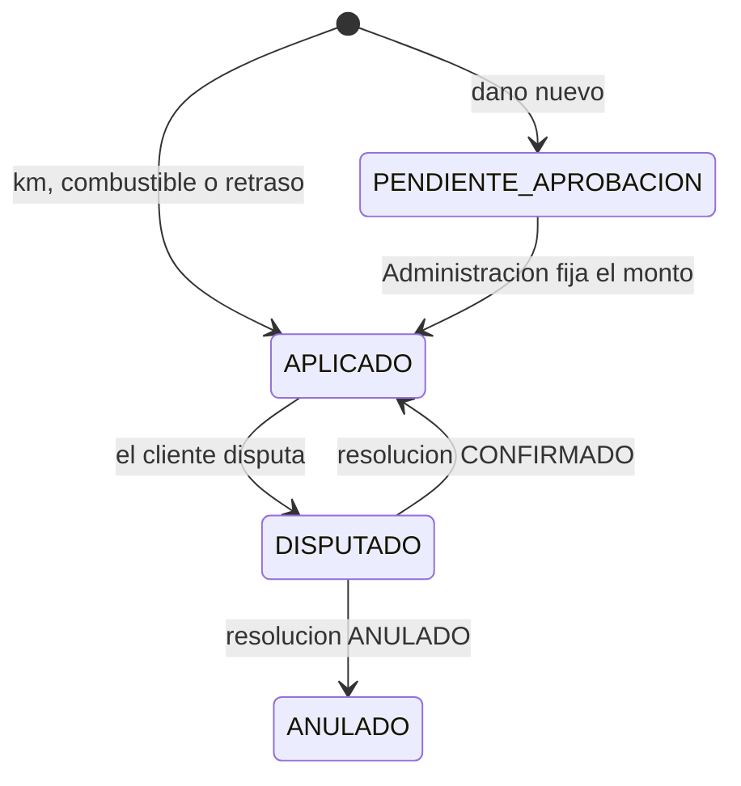
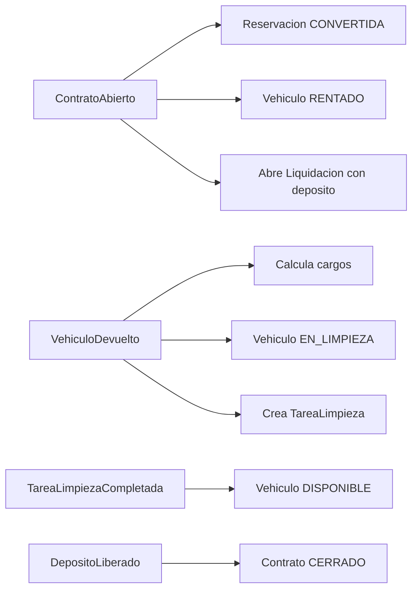
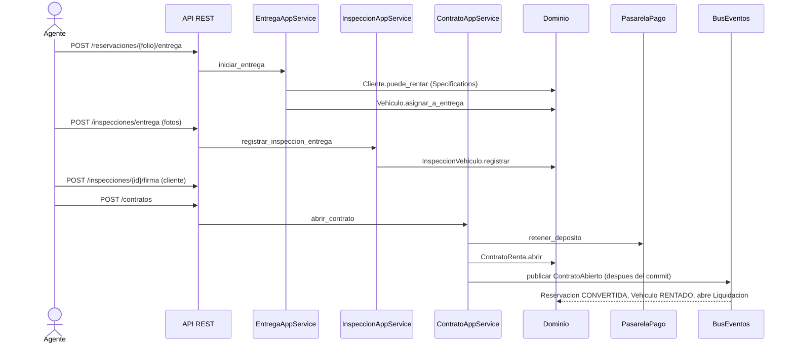
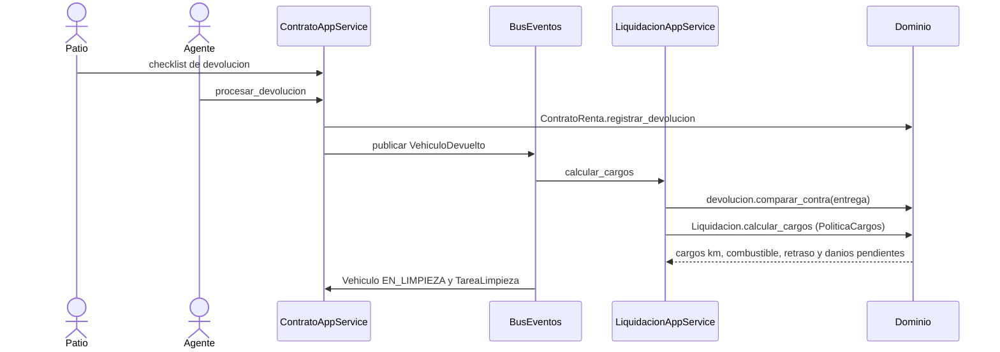
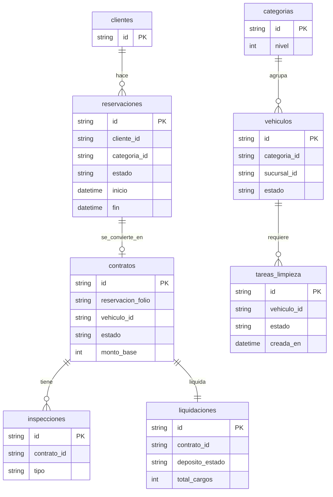
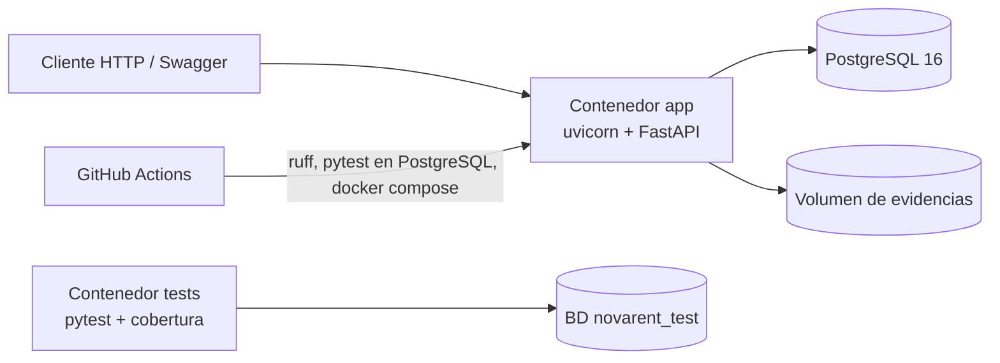

# Arquitectura · NovaRent

Implementa el diseño de la Unidad 3 (ACT-F03): **Domain Model + Service Layer**, con **Repository**, **Unit of Work**, **Domain Events**, **Specification** y **State Machine**, y **consultas directas** para reportes (CQRS básico). Las decisiones están en los [ADR](#decisiones-de-arquitectura-adr).

## 1. Capas y dependencias
Las flechas son dependencias de código. **El dominio no importa nada de FastAPI, SQLAlchemy ni de la infraestructura**; la aplicación depende de *puertos* (interfaces) que la infraestructura implementa (Inversión de Dependencias).

| Capa | Carpeta | Responsabilidad | No debe |
| :--- | :--- | :--- | :--- |
| API | `src/api` | Traducir HTTP ⇄ comandos/DTO; mapear errores a códigos HTTP | Contener reglas de negocio |
| Aplicación | `src/application` | Orquestar casos de uso, transacciones, permisos por rol y publicación de eventos | Decidir reglas (las decide el dominio) |
| Dominio | `src/domain` | Reglas, invariantes, estados y eventos | Conocer HTTP, SQL o frameworks |
| Infraestructura | `src/infrastructure` | Persistencia, pasarela, evidencia, calendario, bus | Contener reglas de negocio |

## 2. Mapa del dominio (un Aggregate = una transacción)

Los aggregates solo se referencian **por identificador**; las entidades internas (`Extension`, `ConductorAdicional`, `Cargo`, `Deposito`) no se tocan desde fuera de su raíz.

### Value Objects (inmutables, validados al construirse)
`Dinero` (Decimal), `PeriodoRenta`, `Kilometraje`, `NivelCombustible` (octavos), `Licencia`, `MetodoPagoRef` (token + últimos 4), `ReferenciaPago`, `EvidenciaFoto` (con sello de tiempo), `RegistroDanio`, `FirmaDigital`, `Disputa`, `CoberturaSeguro`, `DiferenciasInspeccion`, `CondicionesContrato`.

### Patrones aplicados
| Patrón | Dónde | Por qué |
| :--- | :--- | :--- |
| Specification | `domain/especificaciones.py` (11 especificaciones + combinadores `&`, `\|`, `~`) | Reglas booleanas reutilizables que explican cuál falló (`fallas()`) |
| State Machine | `domain/maquina_estados.py` + una tabla por aggregate | Los estados válidos se declaran una vez; ningún `if` de estado disperso |
| Domain Events | `domain/eventos.py` + `BusEventosEnMemoria` | Aggregates desacoplados; una transacción modifica un solo aggregate |
| Repository + Unit of Work | `infrastructure/repositorios.py`, `unidad_trabajo.py` | El dominio ignora la base de datos; commit/rollback atómico |
| Domain Service / Policy | `domain/politicas.py` | Reglas paramétricas (24 h, 29 min, 48 h…) que cambian por configuración |
| Ports & Adapters | `application/puertos.py` + `infrastructure/adaptadores.py` | Pasarela de pago, evidencia, calendario y reloj sustituibles |
| CQRS básico | `infrastructure/consultas.py` | Reportes con SQL directo, sin hidratar aggregates |

## 3. Máquinas de estados

## 4. Flujo de eventos (consistencia eventual entre aggregates)

Cada handler abre **su propia transacción** y es **idempotente**: si el mismo evento llega dos veces el resultado es el mismo (probado en `TestIdempotenciaDeHandlers`).

## 5. Secuencia: entrega y apertura del contrato

## 6. Secuencia: devolución y cargos

## 7. Persistencia
Una tabla por aggregate con **columnas indexadas** para consultar y un **documento JSON** con el estado completo (ADR-005).

Dinero se guarda en **centavos enteros**; las fechas siempre en UTC (`UTCDateTime`).

## 8. Despliegue

## 9. Principios SOLID en el código
| Principio | Evidencia |
| :--- | :--- |
| S · Responsabilidad única | Cada aggregate protege sus invariantes; cada servicio de aplicación atiende un módulo del negocio |
| O · Abierto/cerrado | Nueva regla = nueva `Especificacion` o nuevo handler, sin modificar los existentes |
| L · Sustitución de Liskov | `RelojFijo`/`RelojSistema`, `PasarelaPagoSimulada`, `AlmacenEvidenciaMemoria`/`Disco` son intercambiables |
| I · Segregación de interfaces | Puertos pequeños (`CalendarioHabil`, `Reloj`, `PasarelaPago`…) en lugar de un "servicio de infraestructura" único |
| D · Inversión de dependencias | `application/puertos.py` define las interfaces; `composicion.py` es el único lugar que conoce las implementaciones |

## Decisiones de arquitectura (ADR)
| ADR | Decisión |
| :--- | :--- |
| [ADR-001](ADR-001-domain-model-service-layer.md) | Domain Model + Service Layer |
| [ADR-002](ADR-002-reportes-consultas-directas.md) | Reportes con consultas directas |
| [ADR-003](ADR-003-specification-y-maquina-de-estados.md) | Specification y máquina de estados declarativa |
| [ADR-004](ADR-004-persistencia-documento-por-aggregate.md) | Persistencia: un documento por aggregate con columnas indexadas |
| [ADR-005](ADR-005-eventos-en-proceso-e-idempotencia.md) | Eventos de dominio en proceso, post-commit e idempotentes |
| [ADR-006](ADR-006-api-rest-y-contrato-de-errores.md) | API REST y contrato de errores |
| [ADR-007](ADR-007-autenticacion-simulada-y-autorizacion-por-rol.md) | Autenticación simulada, autorización real por rol |
| [ADR-008](ADR-008-dinero-y-tiempo.md) | Dinero con Decimal y tiempo con zona horaria |
| [ADR-009](ADR-009-configuracion-docker-y-despliegue.md) | Configuración 12-Factor, Docker y CI |
| [ADR-010](ADR-010-adaptacion-del-paquete-de-datos.md) | Adaptación del paquete de datos del PIA |
