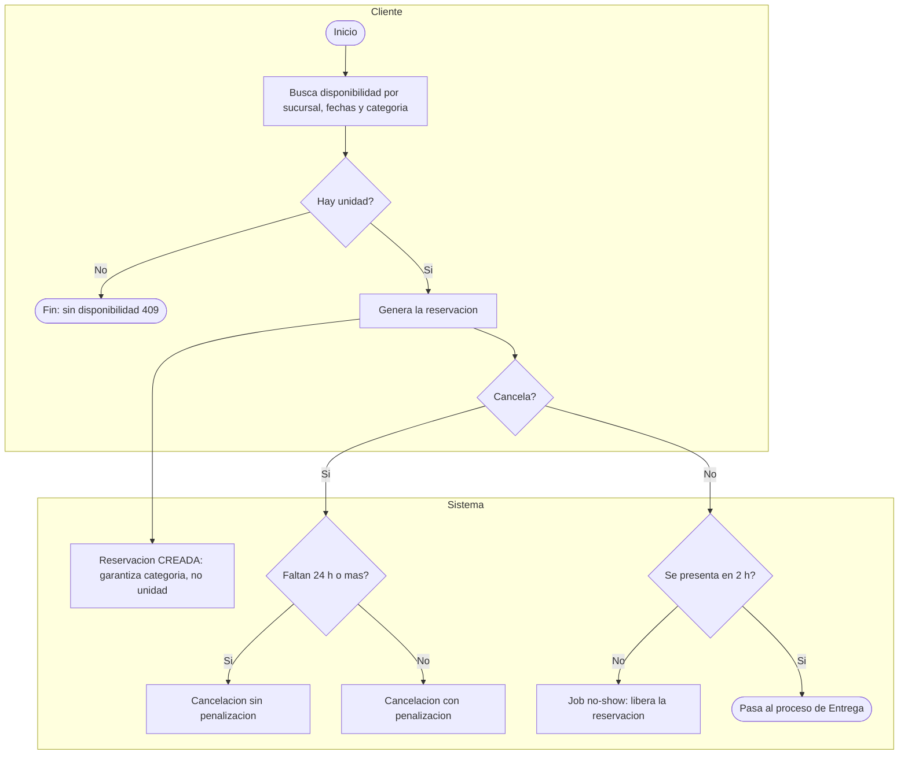
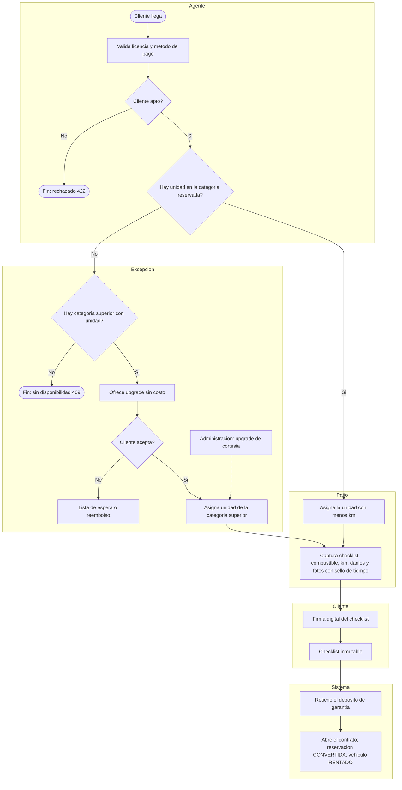
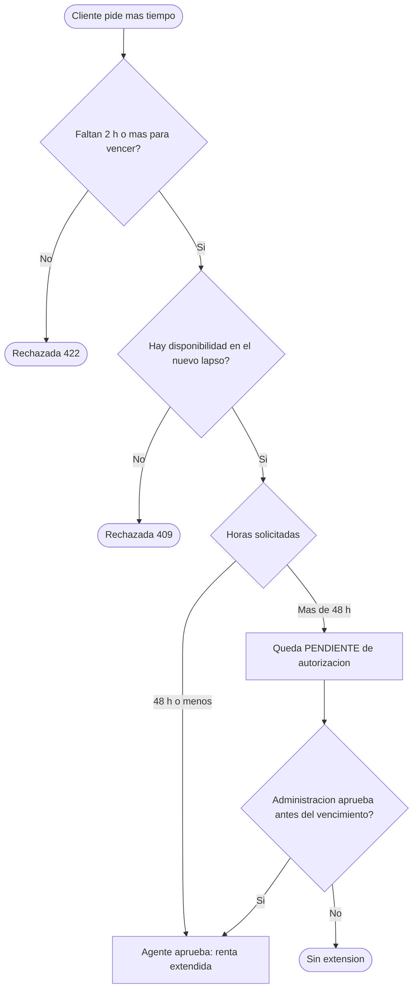
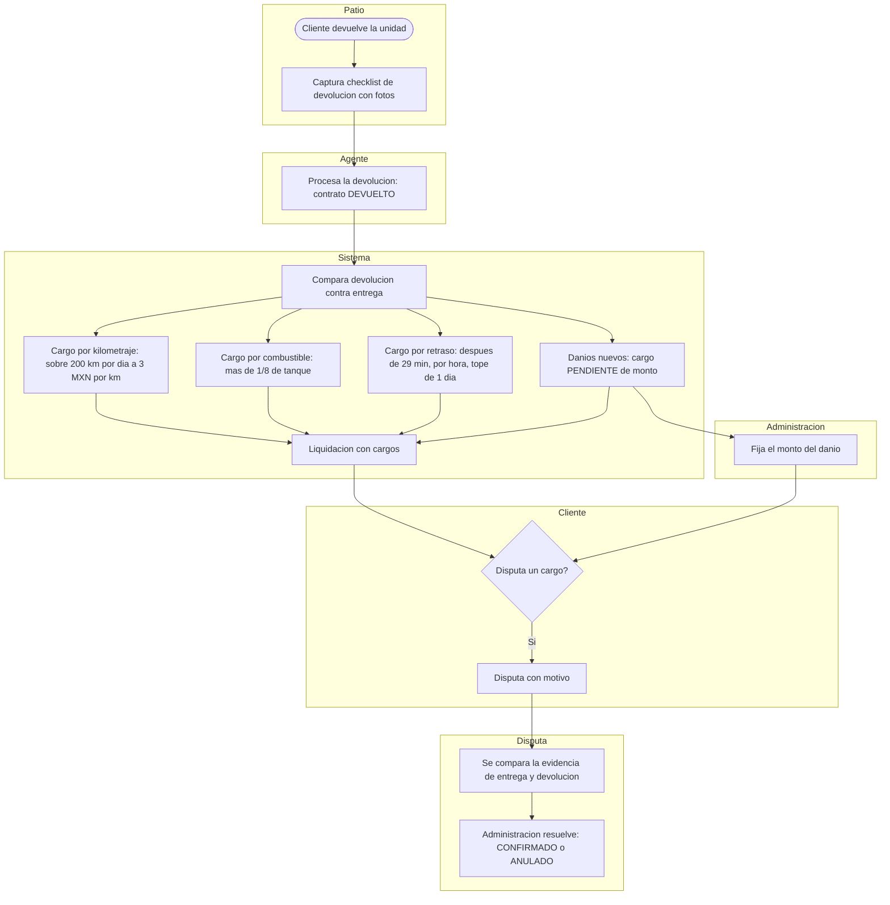
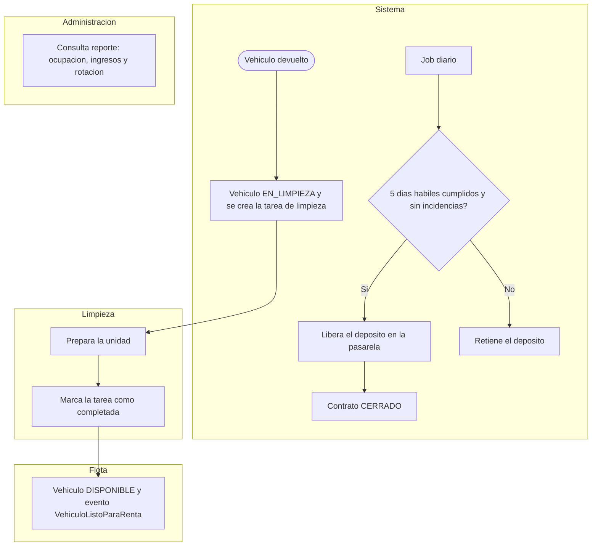

# Procesos de negocio (BPMN) · NovaRent

El diagrama BPMN de U2 se entregó como imagen. Aquí se reexpresa en **Mermaid** (versionable en Git y visible en GitHub), un diagrama por proceso, con los carriles agrupados por actor. Las correspondencias con historias de usuario están en cada título.

## 1. Reservación (US01 · US02 · US03 · US04)

## 2. Entrega y excepciones (US05 · US06 · US07 · US08 · US09 · US10)

## 3. Extensión de renta (US11 · US12)

## 4. Devolución, cargos y disputa (US13 · US14 · US15 · US16 · US17)

## 5. Cierre: limpieza, disponibilidad y depósito (US18 · US19 · US20)

